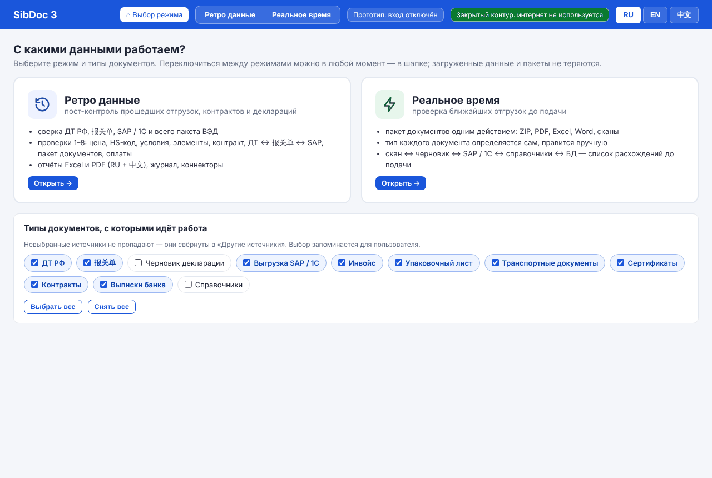
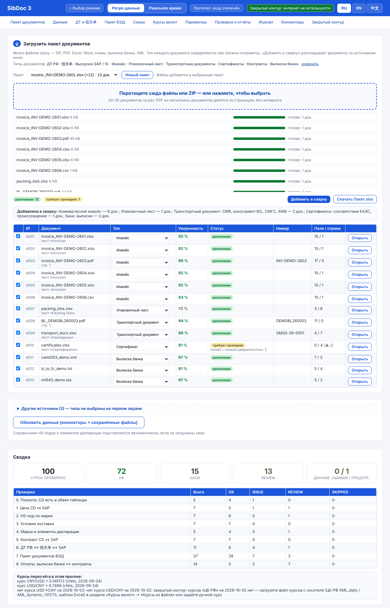
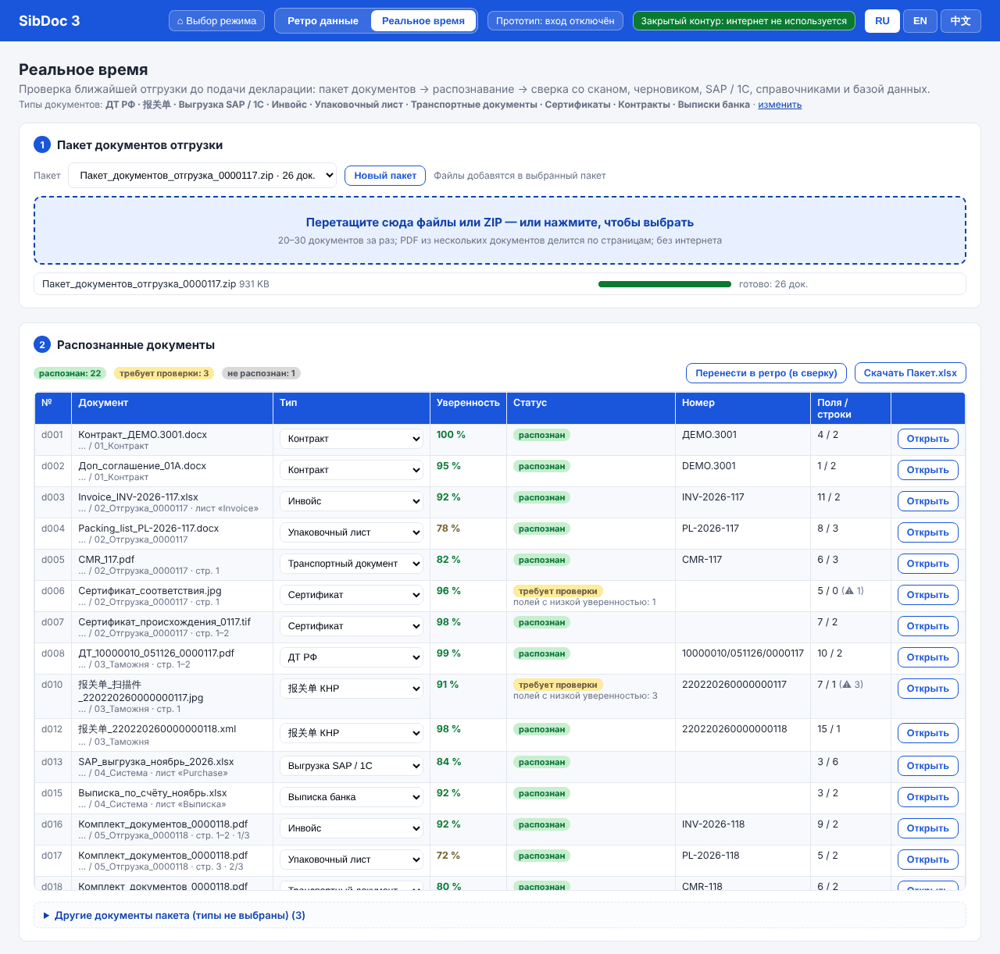
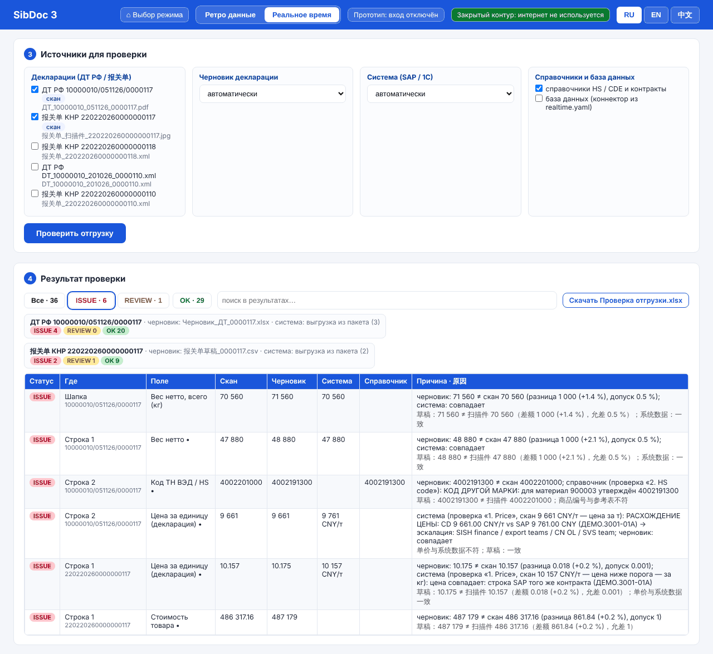
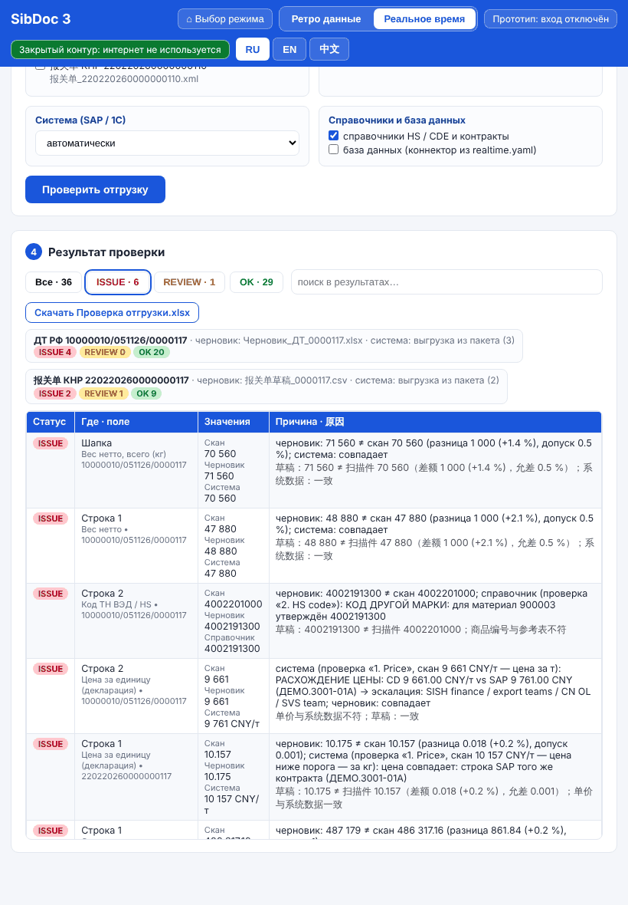

# Реальное время и пакетная загрузка (SibDoc 3)

Второй режим SibDoc 3 — **проверка ближайшей отгрузки до подачи декларации**: пакет документов
загружается одним действием, тип каждого документа определяется автоматически, поля извлекаются в единую
таблицу, а декларация, распознанная со скана, сверяется с черновиком, системными данными (SAP / 1С),
справочниками и базой данных. Результат — таблица расхождений со статусами OK / REVIEW / ISSUE и
причинами по-русски и по-китайски.

Всё работает **без интернета**: распознавание — локальный Tesseract (rus / eng / chi_sim из папки
`tessdata`), классификация — правила, а не облачная модель; курсы валют не запрашиваются (пересчёт
валют включается отдельно, см. §6.5).

Содержание: 1. Как это работает · 2. Форматы · 3. Классификация · 4. Поля и единая таблица ·
5. Пакет: хранение и «Пакет.xlsx» · 6. Проверка отгрузки · 7. Ретро-режим: «добавить в сверку» ·
8. API · 8а. Интерфейс: два режима · 9. Демо-пакет · 10. Для разработчика · 11. Ограничения

---

## 1. Как это работает

```
файлы (ZIP, PDF, Excel, Word, картинки, XML, TXT, письма)
  │  app/intake/formats.py      распаковка, страницы PDF / картинок (текстовый слой или OCR), листы Excel, текст Word
  ▼
части и страницы
  │  app/intake/pipeline.py     PDF из нескольких документов делится по страницам
  │  app/intake/classify.py     тип документа по правилам config/intake/classify.yaml (с объяснением)
  │  app/intake/extract.py      поля единого словаря + товарные строки, у каждого значения — источник и уверенность
  ▼
пакет storage/packages/<id>/     оригиналы, картинки страниц, JSON документов, «Пакет.xlsx»
  │
  ├── ретро:          «добавить в сверку» — ДТ, 报关单, SAP, черновики, пакет ВЭД, выписки банка и договоры
  │                   попадают в слоты пост-контроля
  └── реальное время: app/realtime — скан декларации ↔ черновик ↔ система ↔ справочники ↔ БД
                      -> «Проверка отгрузки.xlsx» + JSON для интерфейса
```

Пакет создаётся в одном из режимов (`retro` — «ретро», `realtime` — «реальное время»), но пользоваться им
можно в обоих: проверку отгрузки можно запустить по любому пакету, а документы любого пакета —
перенести в сверку ретро-режима.

## 2. Поддерживаемые форматы

| Формат | Как читается |
|---|---|
| ZIP | рекурсивно: папки, вложенные архивы (до 4 уровней), имена в UTF-8 и cp866 (архивы из Windows); пароль — документ «ошибка» |
| PDF | постранично: есть текстовый слой — берётся текст и таблицы (PyMuPDF), нет — страница рендерится в 300 dpi и распознаётся OCR; **несколько документов в одном PDF делятся** (§3.4) |
| Excel .xlsx / .xlsm / .xls, CSV / TSV | каждый лист — таблица; кодировки CSV: UTF-8, GBK (GB18030), Windows-1251; разделитель определяется сам; книга из нескольких документов делится по листам |
| Word .docx | без сторонних библиотек (zipfile + XML): абзацы, таблицы, колонтитулы |
| Word .doc, .rtf, .odt, .ods | конвертируются установленным LibreOffice (без сети); нет LibreOffice — документ «не распознан» с понятным сообщением, остальной пакет обрабатывается |
| Картинки JPG / PNG / TIFF (в т. ч. многостраничный) / BMP / GIF / WEBP | OCR Tesseract rus+eng+chi_sim постранично, с уверенностью по каждой строке |
| XML | ДТ ФТС (ESADout_CU) и 报关单 (DecMessage) — по профилям `config/xml_profiles.yaml`; любой другой XML — пары «тег: значение» |
| TXT, HTML | текст |
| EML | письмо (от, кому, тема, текст) — отдельный документ, вложения разбираются как обычные файлы |
| остальное (.dwg, .rar, .msg …) | сохраняется в пакете со статусом **«не распознан»** и подсказкой («сохраните письмо как .eml», «перепакуйте в ZIP»); пакет не падает |

Статусы документа: **распознан** · **требует проверки** (тип не определён или неуверен, есть поля с низкой
уверенностью, нет ключевого поля) · **не распознан** (формат не поддерживается, нет текста, нет Tesseract
для картинки) · **ошибка** (файл повреждён, защищён паролем).

Ограничения объёма — `config/intake/extract.yaml → limits` (500 файлов и 500 МБ на пакет, 300 страниц на PDF,
150 страниц OCR на пакет, 20 000 строк на лист). Предел одного загружаемого файла — `config/system.yaml →
server.max_upload_mb`.

## 3. Классификация: как определяется тип и как его поправить

### 3.1 Типы

| Код | Тип | 中文 |
|---|---|---|
| `ru_dt` | ДТ РФ | 俄罗斯报关单 |
| `cn_dec` | 报关单 КНР | 中国报关单 |
| `draft` | Черновик декларации (обычно Excel) | 报关单草稿 |
| `invoice` | Инвойс | 发票 |
| `packing` | Упаковочный лист | 装箱单 |
| `transport` | Транспортный документ (CMR, коносамент, СМГС, AWB) | 运输单据 |
| `conformity` | Сертификат (соответствия, происхождения, качества) | 证书 |
| `contract` | Контракт, доп. соглашение, спецификация | 合同 |
| `system_export` | Выгрузка SAP / 1С / ERP | 系统导出 |
| `bank` | Выписка банка | 银行对账单 |
| `reference` | Справочник (коды, марки, CDE) | 参考表 |
| `other` | Прочее (письмо, записка) | 其他 |

### 3.2 Признаки и баллы

Правила — `config/intake/classify.yaml`, у каждого типа:

- `keywords` — слова и фразы RU / EN / ZH с весом (`"packing list": 8`, `"报关单": 6`), `re:…` — регулярное
  выражение (`'re:(?<!\d)\d{8}\s*/\s*\d{6}\s*/\s*\d{7}(?!\d)'` — номер ДТ). Регистр, лишние пробелы и
  пробелы между иероглифами (OCR пишет «海关 编号») не важны;
- `titles` — заголовки: ищутся в первых строках страницы / листа (короче 90 знаков) и в имени листа;
- `not` — признаки против типа («черновик» вычитается у ДТ);
- `headers` — поля единого словаря в заголовке таблицы (`material`, `sap_price` → выгрузка SAP);
- `xml_roots` — корневой тег XML (ESADout_CU → ДТ, DecMessage → 报关单);
- `filename` — подсказки в имени файла; `formats` — формат файла;
- `id` — как найти номер документа (для деления PDF и колонки «Номер документа»).

Баллы складываются, побеждает тип с наибольшей суммой.
**Уверенность** = сила × отрыв: сила = min(1, баллы / `strong_score`), отрыв = 0,5 + 0,5 × (баллы − баллы
второго) / баллы. Меньше `min_score` баллов — тип «Прочее», статус «требует проверки»; уверенность ниже
`review_below` (0,6) — тоже «требует проверки».

У каждого документа есть объяснение — `classification.reasons`, например:
`слово «декларац\w*\s+на\s+товары» +6; заголовок «декларац…» +5; слово «таможенная стоимость» +3; …;
второй вариант: 报关单 КНР (1)`.

### 3.3 Как поправить

- **Один документ** — указать тип вручную: `PUT /api/intake/packages/{id}/documents/{doc}/type`
  `{"type": "invoice"}`. Поля извлекаются заново (разборщиком нового типа), «Пакет.xlsx» пересобирается,
  в документе остаётся история (кто и когда менял). `{"type": "auto"}` — вернуть автоматический тип.
- **Все такие документы** — добавить признак в `config/intake/classify.yaml` (слово, заголовок, подсказку в
  имени файла). Перезапуск не нужен: файл перечитывается при изменении.

### 3.4 PDF из нескольких документов

Каждая страница классифицируется отдельно. Новый документ начинается, если в шапке страницы есть заголовок
**другого** типа (после инвойса — «PACKING LIST») или того же типа с **другим номером** (два инвойса подряд:
INV-1 → INV-2). Страницы без заголовка (продолжение таблицы, «стр. 2») присоединяются к предыдущему
документу. Так же делятся многостраничные TIFF и книги Excel (по листам). Почему документ начат здесь —
`split.reason` («стр. 3: заголовок «Упаковочный лист»»).

## 4. Поля и единая таблица

Каждый документ разбирается в **поля единого словаря** (`config/fields.yaml`: `decl_ru`, `contract`,
`container`, `hs_code`, `net_weight`, `unit_price` …) и **товарные строки**:

- таблицы (Excel, CSV, Word, PDF): строка заголовков находится по словарю (не меньше двух подписей полей),
  ниже — товары; строки над таблицей — пары «подпись — значение»; строка «Итого / Total / 合计» — итоги;
- текст (PDF, OCR, Word, TXT): строки «подпись: значение» («38. Вес нетто, кг: 47 880», «净重 : 47880 千克»);
  номер графы и «№» отбрасываются; блок «Товар № 2» / «项号 2» начинает товарную строку;
- XML деклараций — по профилям `config/xml_profiles.yaml`;
- сканы ДТ и 报关单 — ещё шаблоны `config/scan_fields.yaml` для полей, не найденных по подписям;
- номера контейнеров (ISO 6346) и номер ДТ — где бы ни стояли в тексте; OCR-ошибка «DEMUO002019» (O вместо 0)
  исправляется, только если после замены сходится контрольная цифра.

Новая подпись подключается синонимом в `config/fields.yaml` (общий словарь) или в
`config/intake/extract.yaml → extra_synonyms` (только для пакетной загрузки). «Цена» в выгрузке SAP —
цена SAP, в остальных документах — цена за единицу (`remap`).

У каждого значения:

```json
"net_weight": {"value": 47880.0, "raw": "47 880", "conf": 0.95, "valid": true, "note": "",
               "how": "подпись «38. Вес нетто, кг»",
               "source": {"file": "Пакет.zip/03_Таможня/ДТ_…pdf", "page": 1, "line": 20, "method": "text"}}
```

`method`: `xml` · `table` (ячейка: `sheet`, `row`, `col`) · `text` (текстовый слой) · `ocr` (+ `ocr_conf` —
уверенность Tesseract в этой строке) · `pattern` (шаблон). **Уверенность**: XML и таблица — 1,0; текстовый
слой — 0,95; OCR — 0,95 × уверенность строки; шаблон — 0,85 × …; значение не прошло проверку формата
(контрольная цифра контейнера, длина кода ТН ВЭД, дата) — ещё × 0,6. Ниже `field_review_below` (0,75) —
поле на листе «Требует проверки».

Пары «подпись — значение», которых нет в словаре («Номер инвойса: INV-2026-117»), сохраняются в `kv`
документа. Для типов без своего разборщика (инвойс, упаковочный лист, транспорт, сертификаты, выписки банка)
пока так и работает: исходный текст + поля словаря + `kv`. Свои разборщики подключаются реестром (§10).

## 5. Пакет: хранение и «Пакет.xlsx»

```
storage/packages/<id>/          id = ГГГГММДД-ччммсс-xxxx
  meta.json                     режим, создан, пользователь, файлы, список документов, счётчики, прогресс
  originals/                    загруженные файлы как есть
  parts/                        файлы из архивов и писем
  pages/                        картинки страниц (просмотр в интерфейсе)
  docs/d001.json …              документ: страницы / листы (текст, таблицы), тип, причины, поля, товары
  Пакет.xlsx
  realtime/result.json, realtime/Проверка отгрузки.xlsx
```

**«Пакет.xlsx»:**
- «Документы» — файл, откуда (архив / письмо), страницы / листы, формат, тип, уверенность, как определён
  (автоматически / вручную), статус и причина, номер документа, число полей и строк, признаки типа;
- лист на каждый тип («ДТ РФ», «Инвойс», …) — «Поля документов» (строка = документ, колонка = поле, в
  примечании ячейки — источник и уверенность, сомнительные — жёлтые) и «Товарные строки»;
- «Требует проверки» — поля с низкой уверенностью / не прошедшие проверку и документы без типа;
- «Источники полей» — каждое значение: файл, страница / лист, строка, колонка, способ, уверенность.

## 6. Проверка отгрузки в реальном времени

### 6.1 Что с чем сравнивается

Декларация — документ типа `ru_dt` или `cn_dec`. По умолчанию проверяются все декларации **со сканов**
(PDF и картинки) пакета; любую другую (XML) можно выбрать явно. Для каждой:

| Источник | Откуда | Как выбирается |
|---|---|---|
| **черновик** (`draft`) | документ типа «Черновик декларации» в пакете | та же сторона (РФ / КНР), общие контейнеры, номер декларации, контракт; или явно |
| **система** (`system`) | выгрузка SAP / 1С из пакета; если её нет — данные ретро-слотов (Purchase, wide table, коннекторы) | строки по контейнерам декларации и номеру ДТ; если контейнеров нет — по контракту |
| **справочник** (`reference`) | `references/` (HS-коды, CDE), справочники и контракты пакета, `references/contracts.csv` (если есть) | — |
| **БД** (`database`) | коннектор `type: database` (`config/system.yaml → connectors`), указанный в `realtime.yaml → database.connector` | по контейнерам |

### 6.2 Строки результата

Одна строка = одно поле шапки или одно поле товарной строки:

```json
{"declaration": "10000010/051126/0000117", "level": "Строка 1", "field": "net_weight",
 "label": "Вес нетто", "label_zh": "净重", "scan": "47 880", "draft": "48 880", "system": "47 880",
 "reference": "", "database": "", "status": "ISSUE",
 "reason": "черновик: 48 880 ≠ скан 47 880 (разница 1 000 (+2.1 %), допуск 0.5 %); система: совпадает",
 "reason_zh": "草稿：48 880 ≠ 扫描件 47 880（差额 1 000 (+2.1 %)，允差 0.5 %）；系统数据：一致",
 "scan_conf": 0.95, "scan_source": "стр. 1, текстовый слой", "key": true,
 "matched_by": "№ строки, контейнер, код (4 знака), наименование / марка"}
```

Статус строки — худший из сравнений: **ISSUE** — расхождение ключевого поля; **REVIEW** — расхождение
неключевого поля, совпал только основной контракт, совпали первые 6 знаков кода, ключевое поле не
распознано на скане, разные валюты без пересчёта; **OK** — совпало со всеми, с чем было что сравнить.
Если значение скана распознано с уверенностью ниже `ocr_review_below` (0,6), ISSUE смягчается до REVIEW
«проверить по оригиналу». Строки черновика, не найденные в декларации, и наоборот — ISSUE.

Шапка: номер декларации, контракт, условия поставки, валюта, контейнеры, отправитель, получатель, место
поставки, дата, общая стоимость, **общий вес нетто** (сумма строк скана ↔ черновик ↔ сумма системы).
Строки: код ТН ВЭД, наименование, марка, 申报要素, страна, количество, вес нетто / брутто, цена, стоимость,
контейнеры. Строки скана и черновика сопоставляются **не по порядку**, а по баллам: № строки, общий контейнер,
первые 4 знака кода, похожее наименование / марка (`realtime.yaml → match`).

### 6.3 Логика существующих проверок

Чтобы правила не расходились с пост-контролем, используется готовая логика проверок ретро-режима:

| Сравнение | Проверка | Что даёт |
|---|---|---|
| цена ↔ система | «1. Price» | строки SAP своего контракта, повторный контейнер (2.3.1), цена за т по единице (кг / т / «/т» в значении) |
| код ТН ВЭД ↔ справочник | «2. HS code» | утверждённый код по материалу SAP (из системной строки контейнера) или по марке |
| условия поставки ↔ система | «3. Incoterms» | C&F = CFR, место отбрасывается, исключение Qingdao/BZA |
| марка / 申报要素 ↔ CDE | «4. Decl. elements» | марка и CAS против мастер-данных (по умолчанию — для 报关单) |
| контракт | `contract_match` | склеенные контракты, «совпал только основной» |

### 6.4 «Проверка отгрузки.xlsx»

- «Сводка» — по каждой декларации: черновик, система, БД, OK / REVIEW / ISSUE, итог;
- «Сверка» — все строки (фильтр включён): поле RU / 中文, скан, черновик, система, справочник, БД, статус,
  причина / 原因, уверенность и место на скане, как сопоставлены строки;
- «Источники» — какие файлы, строки системы и справочники использованы и почему.

### 6.5 Правила — `config/rules/realtime.yaml`

Допуски (`tolerance_pct`, `tolerance_abs`), ключевые поля (`key: true`), способ сравнения (`kind`),
сопоставление строк (`match`), источник системных данных (`system.source`: auto | package | retro | none;
`net_weight_unit`: t | kg | auto), справочники, БД, `currency.convert` (false — разные валюты дают REVIEW
без пересчёта; true — пересчёт модулем курсов: в закрытом контуре включите `config/rates.yaml → offline:
true`, тогда берутся только ручные курсы и кэш). Правится и через API (`PUT /api/realtime/rules`, прежняя
версия сохраняется в истории правил).

## 7. Ретро-режим: «добавить в сверку»

`POST /api/intake/packages/{id}/to-retro` (`{"doc_ids": [...]}` или пусто — все подходящие) переносит
документы пакета в слоты пост-контроля, как кнопка «Сканы → источник»:

| Тип | Слот | Как |
|---|---|---|
| `ru_dt` | `ru_dt` (добавляется к загруженным) | XML — исходным файлом, скан — строками извлечённых полей |
| `cn_dec` | `cn_dec` (добавляется) | так же |
| `system_export` | `purchase` (заменяет) | Excel / CSV — исходным файлом (колонки по словарю), иначе строки |
| `draft` | `cd_drafts` (заменяет) | так же |
| `invoice`, `packing`, `transport`, `conformity` | слоты пакета ВЭД (добавляются) | Excel / CSV — исходным файлом; PDF и сканы — строками полей, которые нашёл разборщик пакета ВЭД (как при загрузке в слот) |
| `bank` | `bank` (добавляется) | исходным файлом (1С «Клиент-банк», camt.05x, MT940, Excel / CSV банка) — формат определяет слот |
| `contract` | `contract_register` (добавляется) | реестр Excel / CSV — исходным файлом; текст договора — строкой извлечённых полей |
| 1С EnterpriseData (`system_export`, XML) | `purchase`, `ru_dt`, `contract_register` | один файл — в каждый слот, для которого в нём есть данные |

Пакет из 20 демо-документов (6 ДТ XML, 报关单, 6 инвойсов, упаковочные листы, накладные, сертификаты, 3 выписки)
одним действием и «В сверку» дают те же числа проверок, что загрузка файлов в слоты по одному (`verify.sh`):
«7. Пакет документов» — 37 строк, 28 OK / 7 ISSUE / 2 REVIEW (тест `tests/test_sibdoc3_glue.py`).

Файлы сохраняются в папке слота (`storage/uploads/<слот>/пакет_<doc>_…`), поэтому переживают перезапуск;
событие пишется в журнал.

## 8. API

Все пути под `/api`, вход — как у остального API (при `auth.disabled: false` — cookie или `Authorization:
Bearer`). Модуль — `app/api_intake.py`.

| Метод | Путь | Что делает |
|---|---|---|
| GET | `/api/intake/info` | форматы, `ocr.tesseract`, `ocr.langs`, `libreoffice`, типы (RU / EN / ZH), подключённые разборщики, пределы, режимы, статусы |
| GET | `/api/intake/packages` | пакеты: id, режим, название, создан, статус, `counts`, число документов и файлов |
| POST | `/api/intake/packages` | **новый пакет**: multipart `files` (сколько угодно), формы `mode` (`realtime` \| `retro`), `title`; `?wait=true` — ответ после обработки (200), иначе сразу 202 и обработка в фоне |
| POST | `/api/intake/packages/{id}/files` | добавить файлы в пакет (так же `?wait=`) |
| GET | `/api/intake/packages/{id}` | `meta`: режим, файлы, `documents` (сводки), `counts`, `progress` |
| GET | `/api/intake/packages/{id}/status` | `status` (`processing` \| `done` \| `error`), `progress` {stage, done, total, current, documents, seconds, ocr_pages}, `message` |
| DELETE | `/api/intake/packages/{id}` | удалить пакет |
| GET | `/api/intake/packages/{id}/documents?type=&status=` | документы с типами |
| GET | `/api/intake/packages/{id}/documents/{doc}` | документ: поля с источниками, товары, `kv`, `classification` (баллы и причины), `text`, `pages_info` (картинки страниц, способ, уверенность OCR), `original_url`; `?units=true` — ещё страницы целиком |
| PUT | `/api/intake/packages/{id}/documents/{doc}/type` | `{"type": "invoice"}` или `{"type": "auto"}` → документ с новыми полями |
| GET | `/api/intake/packages/{id}/documents/{doc}/original` | исходный файл |
| GET | `/api/intake/packages/{id}/documents/{doc}/pages/{n}` | картинка страницы (JPEG) |
| GET | `/api/intake/packages/{id}/excel` | «Пакет.xlsx» |
| POST | `/api/intake/packages/{id}/to-retro` | «добавить в сверку» (§7): `{"added": {слот: {documents, rows, replaced}}, "skipped": [...]}` |
| POST | `/api/realtime/{id}/check` | **проверка отгрузки** (тело ниже) → результат |
| GET | `/api/realtime/{id}/result` | последний результат |
| GET | `/api/realtime/{id}/excel` | «Проверка отгрузки.xlsx» |
| GET / PUT | `/api/realtime/rules` | правила `realtime.yaml` (PUT пишет журнал с diff) |

Сводка документа в `meta.documents` / `…/documents`:

```json
{"id": "d008", "file": "Пакет.zip/03_Таможня/ДТ_10000010_051126_0000117.pdf", "name": "ДТ_…pdf",
 "container": "Пакет.zip", "format": "pdf", "pages": [1, 2], "sheets": [], "type": "ru_dt",
 "type_label": "ДТ РФ", "type_label_zh": "俄罗斯报关单", "type_auto": "ru_dt", "type_source": "auto",
 "confidence": 0.99, "status": "распознан", "status_reason": "", "doc_number": "10000010/051126/0000117",
 "fields": 10, "items": 2, "review_fields": 0, "split": {}, "warnings": []}
```

Тело проверки отгрузки (все поля необязательны):

```json
{"declarations": ["d008"],          // пусто — все декларации со сканов
 "draft": "auto",                  // auto | none | ["d009"]
 "system": "auto",                 // auto | package | retro | none | ["d013"]
 "references": true, "database": false}
```

Ответ: `{"package_id", "created", "counts": {"OK", "REVIEW", "ISSUE", "total"}, "excel": "/api/realtime/{id}/excel",
"declarations": [{"doc_id", "file", "type", "number", "side": "ru" | "cn", "draft": {doc_id, file, reason},
"system": {source, docs, lines, reason, note}, "database": {...}, "references": [...], "counts": {...},
"rows": [строки §6.2, ISSUE → REVIEW → OK]}]}`.

Журнал: события `intake` (пакет, файлы), `intake_type` (тип вручную), `intake_to_retro`, `realtime_check`.

Как этим пользуется интерфейс (§8а): названия типов — `/api/intake/info → types`; загрузка — `POST
/api/intake/packages` (или `…/{id}/files`) без `wait`, прогресс передачи — по байтам запроса, затем опрос
`GET /api/intake/packages/{id}` раз в секунду (`progress.done / total`, `progress.current`, документы по мере
разбора); правка типа — `PUT …/type`; «Добавить в сверку» — `to-retro` с `doc_ids` отмеченных документов;
«Проверить отгрузку» — `POST /api/realtime/{id}/check`, при повторном открытии пакета — `GET …/result`.

## 8а. Интерфейс: два режима

Решение пользователя 05.11.2026: «разделяем инструмент на два блока для выбора: работа с ретро данными и
работа с данными в реальном времени… сразу возможность выбора, с каким типом документов будет идти работа, а
также возможность переключения между этими двумя экранами». Код — `webui/modes.js` (подключён в
`webui/index.html` одной строкой, только свой сервер — закрытый контур), снимки — `docs/screens/`.



- **Первый экран** — две большие карточки: «Ретро данные · пост-контроль прошедших отгрузок, контрактов и
  деклараций» и «Реальное время · проверка ближайших отгрузок до подачи»; под ними — типы документов
  (флажки): ДТ РФ, 报关单, черновик декларации, выгрузка SAP / 1С, инвойс, упаковочный лист, транспортные
  документы, сертификаты, контракты, выписки банка, справочники. Выбор (режим, типы, открытые пакеты)
  запоминается для пользователя в браузере (`localStorage`, ключ `sibdoc3.ui.<логин>`; при выключенном
  входе — `local`); последний режим отмечен на карточке.
- **Шапка**: «⌂ Выбор режима» и переключатель «Ретро данные | Реальное время» — в любой момент; экраны только
  прячутся, поэтому загруженные источники, пакеты, результат проверки и фильтры остаются на месте. Рядом —
  плашка «Закрытый контур». Адрес `/?mode=retro` или `/?mode=realtime` открывает режим сразу.
- **Ретро данные** — прежний пост-контроль (источники, карточки ДТ / 报关单 и пакета ВЭД, сканы, курсы,
  параметры, проверки 0–8, отчёты, журнал, статус коннекторов). Источники невыбранных типов свёрнуты в
  «Другие источники» (с пометкой, если среди них незагруженные обязательные). Сверху — **«Загрузить пакет
  документов»**: перетаскивание файлов / ZIP, прогресс по файлам, список документов с типом (правится в
  выпадающем списке), уверенностью и статусом, флажки и **«Добавить в сверку»** (`to-retro`, §7), «Скачать
  Пакет.xlsx».

  
- **Реальное время** — четыре шага:
  1. «Пакет документов отгрузки»: перетащите файлы или ZIP (или нажмите и выберите); выбор пакета из списка,
     «Новый пакет»; новые файлы добавляются в выбранный пакет. Прогресс — по каждому файлу: передача (%),
     в очереди, разбор (с именем файла внутри архива), готово: N документов.
  2. «Распознанные документы»: тип (выпадающий список — поля извлекаются заново), уверенность, статус
     (распознан / требует проверки / не распознан / ошибка) с причиной, номер, поля / строки, «Открыть» —
     поля с источником (лист, строка, колонка, страница), строки, почему такой тип, текст; документы
     невыбранных типов — в «Другие документы пакета». «Скачать Пакет.xlsx», «Перенести в ретро (в сверку)».
  3. «Источники для проверки»: какие декларации (по умолчанию — сканы), черновик (автоматически / не
     использовать / конкретный), система (автоматически / выгрузка из пакета / данные ретро-режима / не
     использовать / конкретная выгрузка), справочники, база данных → **«Проверить отгрузку»**.
  4. «Результат проверки»: фильтр Все / ISSUE / REVIEW / OK с числами, поиск, сводка по декларациям (какой
     черновик и какие системные данные взяты), таблица «статус — где — поле — скан / черновик / система /
     справочник / БД — причина» (по-русски и 中文 под ней; в режиме 中文 — наоборот), «Скачать Проверка
     отгрузки.xlsx».

  
  
- Языки RU / EN / 中文 — тексты модуля в одном JSON (`/*SD3-I18N*/`), тест сверяет ключи. Ширина — от 1280 px
  до планшета (768 px): на узком экране таблицы документов и результата складываются в 4–5 колонок без
  прокрутки вбок.

  

## 9. Демо-пакет

```bash
python3 tools/make_demo_package.py     # -> data/demo/package/Пакет_документов_отгрузка_0000117.zip + expected.json
```

Один ZIP (папки, архив в архиве, письмо с вложениями), 26 документов, все данные вымышленные: ДТ PDF с
текстовым слоем (2 страницы, 2 товара), черновик ДТ Excel, 报关单 скан JPG и черновик 报关单 CSV (GBK),
报关单 XML, инвойс Excel, упаковочный лист Word, CMR PDF, сертификат соответствия JPG, сертификат
происхождения TIFF (2 страницы), контракт, доп. соглашение и спецификация Word, выгрузка SAP Excel,
справочник Excel, выписка банка, PDF из трёх документов (инвойс на 2 страницах, упаковочный лист, CMR),
письмо EML, TXT, архив прошлых отгрузок (ДТ XML, 报关单 XML во вложенном ZIP) и файл чертежа `.dwg`.

Заложенные расхождения и результат проверки отгрузки (`realtime.run`, всё по умолчанию):

| Декларация | Где | Что заложено | Статус |
|---|---|---|---|
| ДТ …0000117 (PDF) | строка 1, вес нетто | черновик 48 880 vs скан 47 880 (SAP 47 880) | ISSUE |
| | шапка, вес нетто всего | 71 560 vs 70 560 | ISSUE |
| | строка 2, код ТН ВЭД | черновик 4002191300 vs скан 4002201000; справочник: для материала 900003 утверждён 4002191300 | ISSUE |
| | строка 2, цена | SAP 9 761 vs 9 661 CNY/т (проверка «1. Price») | ISSUE |
| 报关单 …0117 (JPG) | цена и стоимость | черновик 10.175 vs скан 10.157 (с SAP совпадает: 10 157 CNY/т) | ISSUE ×2 |
| | наименование | OCR прочитал иероглифы с ошибкой | REVIEW |

Итого 36 строк: **OK 29, REVIEW 1, ISSUE 6**; точность классификации на демо — **26 из 26**. Пакет
разбирается примерно за 6 секунд (4 страницы OCR).

## 10. Для разработчика

- **Новый разборщик документа** (инвойсы, CMR, выписки — ветки пакета ВЭД и коннекторов):

  ```python
  from app.intake.extract import register_extractor, generic

  def parse_invoice(ctx):                  # DocContext: type, units (страницы / листы: lines, tables), file, data
      res = generic(ctx)                   # общий разбор по словарю
      res["fields"]["invoice_no"] = ...    # своё поле: {"value", "raw", "conf", "valid", "source", "how"}
      return res                           # None — «не мой», следующий разборщик

  register_extractor("invoice", parse_invoice, name="инвойс", priority=50)
  ```
  Модуль разборщика достаточно импортировать (например, из `app/intake/__init__.py`). Новые типы
  документов — блок в `config/intake/classify.yaml`; новые поля — в `config/fields.yaml`.
- Разборщики веток (пакет ВЭД, выписки банка, реестр договоров, 1С EnterpriseData) подключены в
  `app/intake/plugins.py`: документ, который весь файл, читается тем же кодом, что и слот ретро-режима
  (байты файла — `DocContext.data`, часть файла — `DocContext.split`), часть многодокументного файла — по
  своим таблицам; источник значения — лист, строка, колонка.
- Новый слот для «добавить в сверку» — `RETRO_SLOTS` (и `WHOLE_FORMATS`) в `app/api_intake.py`.
- Интерфейс: `webui/modes.js` — экраны, типы документов (`TYPES`, `TYPE_SLOTS`), пакет (`makePack`), реальное
  время (`RT`); тексты — JSON `/*SD3-I18N*/`; тесты — `tests/test_ui_modes.py` (в т. ч. прогон в браузере).
- Тесты: `tests/test_intake.py` (форматы, деление PDF, классификация, поля, правка типа, Excel, API, работа без
  сети), `tests/test_realtime.py` (статусы проверки отгрузки, источники, сравнения, БД). OCR-тесты
  пропускаются без Tesseract, тест `.doc` — без LibreOffice.

## 11. Ограничения

- Таблицы со **сканов** (OCR) в товарные строки не собираются: со скана берутся поля «подпись: значение»
  и блоки «Товар № N» / «项号 N»; многострочные товарные таблицы надёжно читаются из PDF с текстовым
  слоем, Excel, Word.
- Китайский текст на шумных сканах Tesseract читает хуже: такие поля получают низкую уверенность и попадают в
  «Требует проверки» (на демо — наименование 报关单).
- Деление PDF опирается на заголовки и номера документов в шапке страницы; документ без заголовка
  присоединяется к предыдущему — поправьте тип вручную.
- Инвойсы, упаковочные листы, транспортные документы и сертификаты разбираются разборщиком пакета ВЭД
  (`app/services/package_docs.py`), выписки банка — `bank_statements` (1С, camt, MT940, CSV / Excel), реестр
  договоров и 1С EnterpriseData — их разборщиками (`app/intake/plugins.py`); общий разбор дополняет их. Текст
  договора (Word / PDF) и прочие документы — общим разборщиком.
- `.doc` / `.rtf` / `.odt` / `.ods` — только при установленном LibreOffice; `.rar`, `.7z`, `.msg` не
  поддерживаются.
- Пересчёт валют выключен по умолчанию (закрытый контур); разные валюты дают REVIEW.
